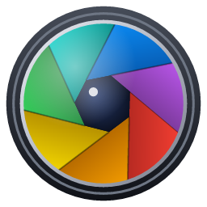
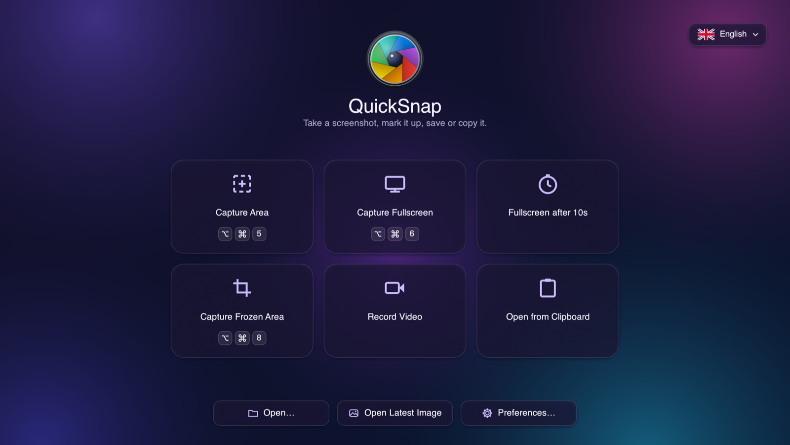
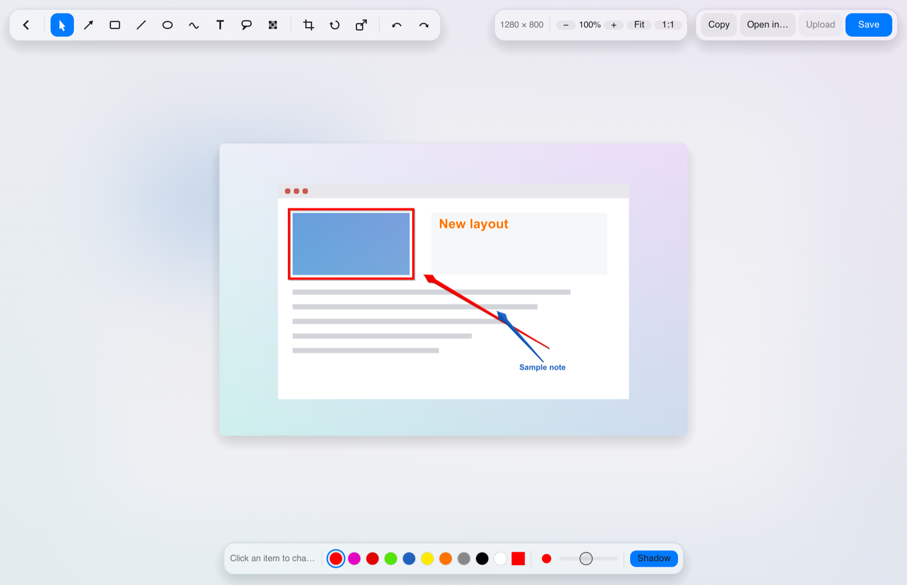
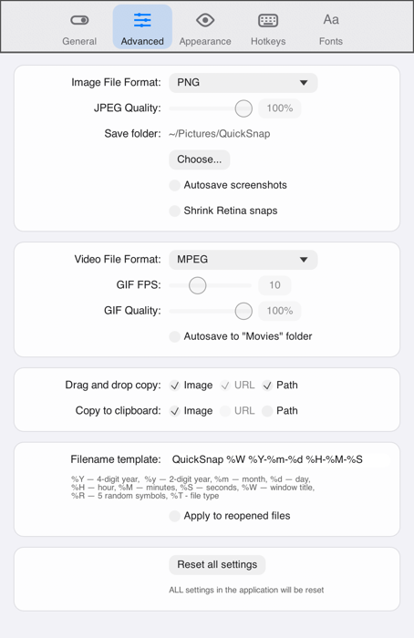
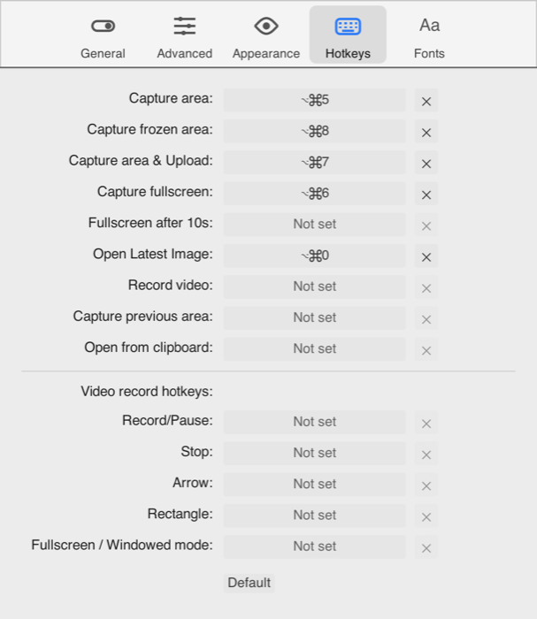

<div align="center">



# QuickSnap

**A lightweight screenshot and annotation tool for macOS, written in Rust.**


</div>

QuickSnap lives in your menu bar. Press a hotkey, grab part of the screen, mark it up,
then save or copy it, with no accounts, no uploads and no telemetry.

<p align="center">
  
</p>

## Contents

- [Features](#features)
- [Screenshots](#screenshots)
- [Install](#install)
- [Usage](#usage)
- [Build from source](#build-from-source)
- [Project layout](#project-layout)
- [Workflow and versions](#workflow-and-versions)
- [Roadmap](#roadmap)
- [Credits](#credits)
- [License](#license)

## Features

- **Capture:** selected area, frozen area (screen is frozen while you select), full
  screen, and full screen after a 10-second delay
- **Record video:** full-screen recording to `.mov`, with cursor and clicks shown
- **Annotate:** arrows, rectangles, ellipses, lines, freehand pen, text and text callouts,
  with a colour palette (or any custom colour, also by hex code) and line width; every
  item can be moved and resized afterwards
- **Zoom:** pinch on the trackpad or ⌘ + scroll around the pointer, or the zoom menu
- **Drop shadow:** optional soft shadow around the exported picture (transparent PNG),
  like macOS window screenshots
- **Redact and trim:** blur sensitive areas (movable, resizable), crop, rotate and resize
- **Undo/redo:** up to 40 steps
- **After each capture:** open the editor, save to a folder, copy to the clipboard, or
  open in an external editor such as Preview
- **Configurable:** global hotkeys, save folder, PNG/JPEG, file-name templates
  (`%Y-%m-%d %H-%M-%S`, window title…), light/dark appearance and fonts
- **Menu-bar app:** lives in the menu bar with no Dock icon; closing the window keeps it
  running, and every command is also in the menu-bar icon's menu
- **15 languages:** English, Spanish, Catalan, Galician, Basque, French, German, Italian,
  Portuguese (Portugal and Brazil), Dutch, Polish, Japanese, Chinese (simplified) and
  Korean, picked from the home screen or Preferences
- **Launch at login:** optional, from Preferences → General
- **Glass look:** see-through window with the desktop blurred behind it, colour-gradient
  backdrop and no title bar (only the window buttons)
- **Small and native:** a single Rust binary, ~5 MB DMG

## Screenshots

<p align="center">
  
  <br><em>Annotation editor</em>
</p>

<table>
  <tr>
    <td align="center"><br><em>Preferences: Advanced</em></td>
    <td align="center"><br><em>Preferences: Hotkeys</em></td>
  </tr>
</table>

## Install

1. Download `QuickSnap-<version>.dmg` from the
   [Releases](../../releases) page.
2. Open it and drag **QuickSnap** to **Applications**.
3. Launch QuickSnap from Launchpad or Spotlight.

> [!IMPORTANT]
> QuickSnap is **not notarized by Apple yet**. The first time you open it, macOS will
> say it cannot verify the app. Go to **System Settings → Privacy & Security**, scroll
> down and click **Open Anyway**. You only need to do this once per version.

> [!NOTE]
> To take screenshots, QuickSnap needs the **Screen Recording** permission
> (**System Settings → Privacy & Security → Screen Recording**). Quit and reopen the app
> after granting it.

Release builds are currently for **Apple Silicon** Macs. On Intel Macs, build from source.

## Usage

Default hotkeys (change them in **Preferences → Hotkeys**):

| Action | Hotkey |
|---|---|
| Capture area | <kbd>⌥</kbd> <kbd>⌘</kbd> <kbd>5</kbd> |
| Capture full screen | <kbd>⌥</kbd> <kbd>⌘</kbd> <kbd>6</kbd> |
| Capture frozen area | <kbd>⌥</kbd> <kbd>⌘</kbd> <kbd>8</kbd> |
| Open latest image | <kbd>⌥</kbd> <kbd>⌘</kbd> <kbd>0</kbd> |
| Full screen after 10 s, record video, capture previous area, open from clipboard | not set |

> [!TIP]
> A global hotkey can belong to only one app. If another screenshot tool already uses
> these shortcuts, assign different ones in QuickSnap.

Settings are stored in `~/Library/Application Support/QuickSnap/settings.json`.
Screenshots are saved to `~/Pictures/QuickSnap` by default.

## Build from source

Requirements: macOS 11 or later, [Rust](https://rustup.rs) (stable) and the Xcode
Command Line Tools (`xcode-select --install`).

```bash
git clone <repo-url>
cd quicksnap

cargo run                    # run a development build
cargo test                   # run the tests
cargo build --release        # optimized binary in target/release/quicksnap
```

### Package as `.app` and `.dmg`

```bash
./scripts/package-macos.sh
```

This builds a release binary and writes `dist/QuickSnap.app` and
`dist/QuickSnap-<version>.dmg`. The app is signed ad-hoc (no Apple Developer account
needed), which is enough for the Mac it was built on.

### Developer flags

| Flag | What it does |
|---|---|
| `--screenshot <file.png>` | Opens the editor with a sample picture, saves the window to `file.png` and exits |
| `--write-icon <file.png> <size>` | Renders the app icon to a PNG (used by the packaging script) |
| `--write-tray-icon <file.png> <size>` | Renders the one-ink menu-bar icon to a PNG |

With `--screenshot`, the environment variables `QUICKSNAP_VIEW` (`home`, `prefs-general`,
`prefs-advanced`…), `QUICKSNAP_THEME` (`light`/`dark`), `QUICKSNAP_LANG` (`en`, `es`, `ca`, `gl`, `eu`, `fr`, `de`, `it`, `pt`, `pt-br`, `nl`, `pl`,
`ja`, `zh`, `ko`)
and `QUICKSNAP_WINDOW` (e.g. `1000x620`) choose what is shown.

## Project layout

```
src/
├── main.rs          entry point and command-line flags
├── app.rs           main window, menu-bar icon, command dispatch
├── capture.rs       screen capture, video recording, clipboard, file output
├── editor.rs        annotation editor (tools, canvas, undo/redo)
├── shapes.rs        drawing of arrows, shapes, text, blur, crop
├── overlay.rs       on-screen selection overlay
├── hotkeys.rs       global hotkey registration
├── i18n.rs          interface languages (15) and their flags
├── settings.rs      settings model and persistence
├── settings_ui.rs   Preferences window (General, Advanced, Appearance, Hotkeys, Fonts)
├── theme.rs         light/dark palettes, glass panels, gradients, vibrancy
├── colour_picker.rs custom-colour popup (hex code, colour map, hue bar)
├── icons.rs         vector toolbar icons
└── appicon.rs       app icon, drawn in code
scripts/
├── package-macos.sh build QuickSnap.app and the .dmg
├── install-local.sh build, install into /Applications and relaunch
└── setup-signing.sh one-time local signing certificate (keeps permissions across rebuilds)
docs/                README images
```

## Workflow and versions

The repository follows [git-flow](https://nvie.com/posts/a-successful-git-branching-model/)
(the `git flow` command is configured for it):

| Branch | Purpose |
|---|---|
| `main` | Released versions only; every commit on it is a release, tagged `vX.Y.Z` |
| `develop` | Integration branch; finished features are merged here |
| `feature/<name>` | New work, branched from `develop` and merged back into it |
| `release/X.Y.Z` | Version bump and last fixes, from `develop`; merged into `main` (tagged) and back into `develop` |
| `hotfix/X.Y.Z` | Urgent fix of a release, from `main`; merged into `main` (tagged) and `develop` |

Versions follow [Semantic Versioning](https://semver.org): `X` for incompatible changes,
`Y` for new features, `Z` for fixes. The version lives in `Cargo.toml` (the packaging
script reads it from there) and in the badge at the top of this file; changes are listed
in [CHANGELOG.md](CHANGELOG.md).

```sh
git flow feature start <name>       # … work, commit …
git flow feature finish <name>      # merge into develop
git flow release start X.Y.Z        # bump Cargo.toml, README badge, CHANGELOG.md
git flow release finish X.Y.Z       # merge into main, tag vX.Y.Z, merge back into develop
git push origin main develop --tags
```

## Roadmap

- [ ] Developer ID signing and Apple notarization
- [ ] Universal binary (Apple Silicon + Intel)
- [ ] Text recognition (OCR)
- [ ] Area and window video recording, GIF export

## Credits

Created by **Joan Galtés i Moreno**.

Open-source libraries:

- [egui / eframe](https://github.com/emilk/egui) for the user interface
- [tiny-skia](https://github.com/linebender/tiny-skia) for 2D rendering
- [ab_glyph](https://github.com/alexheretic/ab-glyph) for text rendering
- [image](https://github.com/image-rs/image) for PNG/JPEG encoding
- [global-hotkey](https://github.com/tauri-apps/global-hotkey) and
  [tray-icon](https://github.com/tauri-apps/tray-icon) from the Tauri project
- [arboard](https://github.com/1Password/arboard) for clipboard access
- [rfd](https://github.com/PolyMeilex/rfd) for native file dialogs
- [serde](https://serde.rs), [chrono](https://github.com/chronotope/chrono),
  [dirs](https://github.com/dirs-dev/dirs-rs)

## License

License to be decided. Until a license is added, all rights are reserved.
